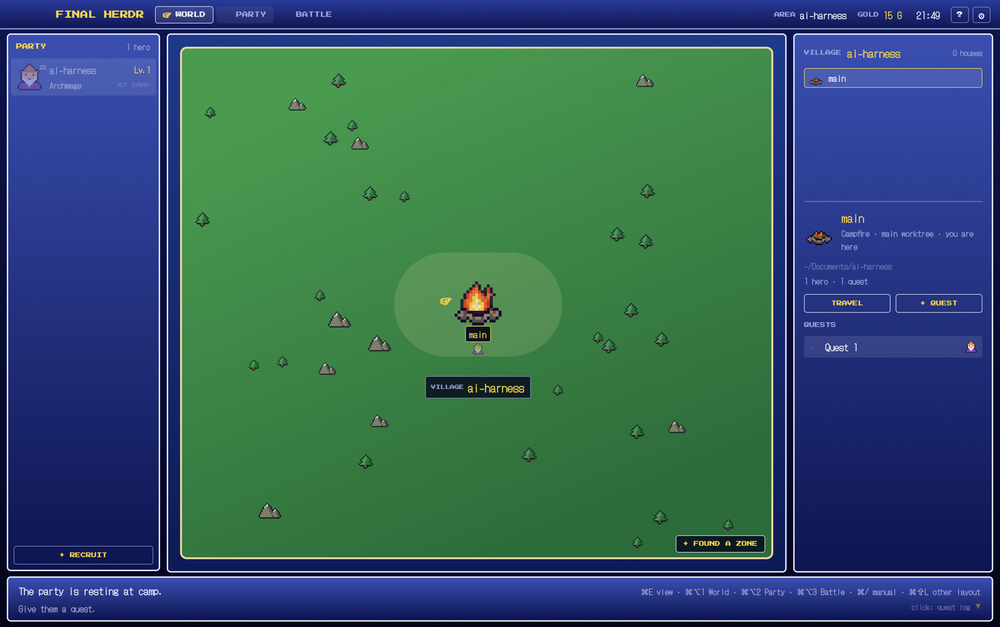

# FINAL HERDR

A JRPG layout for **Herdr UI**. Your coding agents become a party of heroes: they fight quests in your terminals, earn XP and gold, level up, and unlock achievements. Your git repos show up as villages, towns and castles on a world map.



## Contents

```
final-herdr/
├── layouts/final-herdr.json   # the layout (HUD / party / world-party-battle / dialog)
├── layouts/final-herdr.svg    # its preview in Herdr's layout picker
├── themes/final-herdr.json    # color palette
├── mods/fh-*                  # 11 mods: dialog, hud, journal, manual, menu, pane,
│                              # party, roster, title, victory, world
├── keys.json                  # the layout's own shortcuts
├── install.sh                 # automatic install
└── RECIPE.md                  # the brief to rebuild it from scratch
```

The pixel fonts (DotGothic16, Press Start 2P), sounds, portraits and map tiles ship inside the mods. The `art/*.py` scripts next to them regenerate the art.

## Install

### With an agent in Herdr

Ask it to add `herdr.dev/layouts/alingavriliuc/final-herdr`.

### With the script

1. **Quit Herdr UI** (cmd+Q).
2. In a terminal:

   ```bash
   git clone https://github.com/alingavriliuc/final-herdr.git
   cd final-herdr
   ./install.sh                 # layout + theme + mods + shortcuts
   ./install.sh --with-fonts    # same, and installs the pixel fonts in ~/Library/Fonts
   ```

3. Open Herdr UI again. The **final-herdr** layout is active.

Before it changes anything, the script backs up what it replaces in `~/.config/herdr-app/backup-final-herdr-<date>/`.

### By hand

Keep Herdr UI closed during these steps.

```bash
D=~/.config/herdr-app
mkdir -p $D/mods $D/layouts $D/themes
cp -R mods/fh-*            $D/mods/
cp layouts/final-herdr.*   $D/layouts/
cp themes/final-herdr.json $D/themes/
```

Then add the `"layout:final-herdr"` block from `keys.json` to `~/.config/herdr-app/keys.json`, at the same level as `"global"` and `"terminal"`. In Herdr UI, press `cmd+shift+L` and pick **final-herdr**.

### Requirements

- Herdr UI, opened at least once so that `~/.config/herdr-app/` exists.
- `python3` for `install.sh` (macOS ships it with the Command Line Tools).
- Optional: **JetBrains Mono** for the terminals (`brew install --cask font-jetbrains-mono`). Without it, Herdr uses its default font.

## Shortcuts

| Shortcut | Action |
|---|---|
| `cmd+E` | Next view (World → Party → Battle) |
| `cmd+alt+1` | **World**: the map of your repos and spaces |
| `cmd+alt+2` | **Party**: hero sheets and achievements |
| `cmd+alt+3` | **Battle**: the terminals |
| `cmd+/` | The player's manual |

## How it plays

- **Heroes** are your agents. Each agent program has a class: OpenCode is the Engineer, Claude the Archmage, Codex the Alchemist, Cursor the Thief, Copilot the Bard. A plain shell is a Villager.
- **Quests** are tabs. A hero earns 1 XP per second in battle (while working), plus 50 XP per completed quest and 25 more if it never got blocked. XP is shared by class.
- **Gold**: one coin per completed quest.
- **Achievements**: 11 to unlock, on the Party screen.
- **World map**: each git repo is a settlement. The main worktree is the campfire, every other worktree a house. Right-click a campfire or a house to travel, build a new worktree, or demolish one.

Progress is saved in `~/.config/herdr-app/shared.json`, under the `fh.save` key.

## What the mods run

- `fh-world` runs `git rev-parse` and `git worktree list` in your spaces' folders to draw the map.
- `fh-menu` runs `git worktree add` and `git worktree remove` when you build or demolish a house (it asks first, and warns about uncommitted changes), and `hc send` when you talk to a hero.
- No mod reaches the network or reads files outside its own folder.

## Uninstall

```bash
rm -rf ~/.config/herdr-app/mods/fh-* \
       ~/.config/herdr-app/layouts/final-herdr.* \
       ~/.config/herdr-app/themes/final-herdr.json
```

Then pick another layout with `cmd+shift+L`, or restore a `backup-final-herdr-*` folder.

## Troubleshooting

- **The layout doesn't show up**: check that Herdr UI was closed during the copy, then open it again.
- **Square or wrong glyphs in the HUD**: run `./install.sh --with-fonts`.
- **A mod shows an error**: your Herdr UI may be older than the one this layout was built with. Update Herdr UI.

## Credits

Fonts: [DotGothic16](https://fonts.google.com/specimen/DotGothic16) and [Press Start 2P](https://fonts.google.com/specimen/Press+Start+2P), under the SIL Open Font License (`mods/fh-hud/fonts/OFL-*.txt`). Portraits, tiles and chiptune sounds are original, generated by the `art/*.py` scripts.

## License

MIT (see `LICENSE`), except the fonts, which keep their SIL Open Font License.
