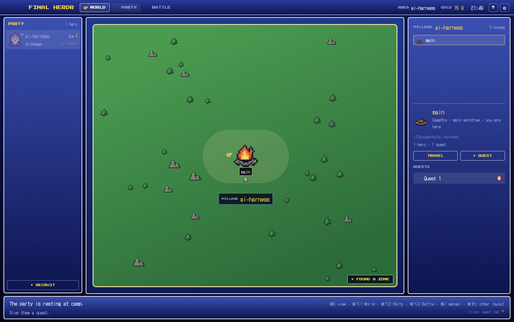

# FINAL HERDR

A 16-bit JRPG skin for Herdr UI. Every agent is a hero with a class and a pixel portrait, every tab is a quest, and the screen switches between a world map of your git repos, a party screen of hero sheets, and the battle view where the terminals live. Agents earn XP, gold and achievements while they work. Blue gradient windows with white rounded borders, gold pixel titles, chiptune sounds.

## What you see

Top to bottom, on a background gradient `#0d1550` → `#03051a` (180°), no titlebar, traffic lights at `[14, 16]`:

1. **HUD** (44px, window-draggable, `fh-hud`). Gradient `#2a3a99` → `#0d1550`, a 2px `#8a92c4` line at the bottom, 84px left padding for the traffic lights. Left to right: `FINAL HERDR` in Press Start 2P 12px gold `#ffd84a`; three view tabs `WORLD` `PARTY` `BATTLE` (Press Start 2P 9px, 26px high; the active one gets a `#ffffff1a` fill, a 1px white border and a gold `☞` that sways left and right); a spacer; `AREA <space name>` (`~` shows as `Home`), `GOLD <n> G` in gold, the clock `HH:MM` (refreshed every 15 s); a `?` button (opens the manual) and a `⚙` button (opens settings).
2. **Body** (row, padding `[6, 10]`, gap 10):
   - **Party column** (`fh-party`, 230px, min 72, max 380). A JRPG window: gradient `#3a4fb0` → `#0d1550`, 2px border `#e8ecff`, radius 6. Header `PARTY` (gold, Press Start 2P 9px) and `N heroes`. One row per agent: 40px portrait, hero name (DotGothic16 14px), `Lv.N` in gold, class name, status label (Press Start 2P 7px in the status color), and while working an ATB gauge plus the elapsed battle time in cyan. Agents sort pinned first, then blocked, done, working, idle. Footer button `+ RECRUIT`. Below 150px wide it becomes a rail of portraits with `PT` and `+`.
   - **View stack** (`view`, active `combat`):
     - `world` (`fh-world`): the map, a 300px side panel on the right. The map is a dark blue frame with a green field (`#4a9a50` → `#2c6b3a`, 160°) inset 18px with a 3px sand border `#e8d8a0`, scattered pixel trees and mountains, a dashed sand path linking the places. Each git repo is a **settlement**: its main worktree is a campfire in the middle of a square, the other worktrees are houses on an ellipse around it; up to 3 houses it's a `Village`, 4-5 a `Town` (cobbled square, town houses), 6+ a `Castle` (stone walls, 4 turrets, a gate). A worktree with no space open is an empty house / unlit fire. Spaces outside a git repo are lone **zones**: `Hometown` for `~`, otherwise a `Tower` or `Dungeon` picked from a hash of the name. Labels in dark pills, gold when you're there; up to 3 hero portraits under each place; `+ FOUND A ZONE` bottom right. The side panel shows the settlement (tier, name, `N houses`, its worktrees list), then the selected place (tile, branch, `Campfire · main worktree` / `House · worktree`, ` · you are here`), its folder, `N heroes · N quests`, `TRAVEL` and `+ QUEST` (or `SETTLE` for an empty house), and a `QUESTS` list of its tabs.
     - `roster` (`fh-roster`): `HERO SHEETS` and `N heroes · N in battle`, then 320×222 cards: 88px portrait, status, name (17px), `sigil Class` in gold, `LEVEL` with `into/need XP` and a gold bar, `ZONE`, `QUEST`, `BATTLE` time, `GO` and `PEEK` buttons. A `+ RECRUIT` card with a dim 2px border ends the grid. Below: `ACHIEVEMENTS n/11`, 250px tiles with `◆` (gold border, unlocked) or `◇` and `???` (locked; the description still shows).
     - `combat`: the active tab's terminals. Panes gap 10, radius 8, background `#0a1036`, border 2px `#aeb4dc`, focused border 2px white, frame even when alone. Each pane has a 28px header on top (`fh-pane`): gold `☞` on the focused pane, 20px portrait, `Class Lv.N` (or `Villager` for a shell), the folder with `~`, the branch in cyan with `⎇`, the status label; split right / split down / zoom / close icons on hover.
3. **Dialog box** (76px, padding `[0, 10]`, `fh-dialog`): a JRPG window. Line 1 (15px): the latest log event with its icon and `N min ago` if under 10 minutes old, else a narration of the party (`<hero> (<Class>) calls for help!`, `… completed a quest!`, `N heroes in battle.`, `The party is resting at camp.`, `Welcome to FINAL HERDR.`). Line 2 (13px, dim): the follow-up line. Right: the key reminder and `click: quest log ▼` (the `▼` blinks).

Terminals use JetBrains Mono 14px, padding `[10, 8]`, opacity 0.9. Mod text uses DotGothic16 (body) and Press Start 2P (titles, labels). The theme `final-herdr` is navy (`#0a1036` background, `#e8ecff` text), gold accent `#ffd84a`, status colors working `#6fe3e3`, blocked `#ff6b6b`, done `#7be07b`, idle `#6a74b0`.

Overlays: the **title screen** (`fh-title`, full window, once per app launch): twinkling stars on `#0d1550` → black, the five class portraits bouncing, `FINAL HERDR` 54px gold with a brown drop shadow, `— Rise of the Agents —`, a blinking `PRESS ENTER`, `N heroes ready · N G in your pocket`, `© 2026 HERDR SOFT · a production of your terminal`. The **manual** (`fh-manual`, 720×620 dialog). The **quest log** (`fh-journal`, 560×460 dialog). The **level-up window** (`fh-victory`, 380×168, gold border): bouncing 88px portrait, `LEVEL UP!`, hero name, `Quest complete · +N XP · flawless`, `★ <Class> reached level N!`; closes itself after 4 s. The **command menu** (`fh-menu`, popup at the pointer).

## How it behaves

Statuses, everywhere a hero shows:

- **working** → label `IN BATTLE` cyan; the portrait bounces; in the party column an ATB gauge of `▮` segments charges in cyan, flashes gold three times when full, and starts over (each hero at its own speed); the battle time counts (`42 s`, `12 min`, `1 h 05`).
- **blocked** → label `HELP!` red, blinking; a red `!` badge on the portrait; the row gets a red tint and the roster card a red border.
- **done** → label `VICTORY` green; a gold `★` pulses on the portrait.
- **idle** → label `AT CAMP` dim; the portrait greys to 45% with an animated `z / zz / zzz`.

Clicks and keys:

- `cmd+E` cycles World → Party → Battle; `cmd+alt+1/2/3` pick one; `cmd+/` opens the manual. The HUD tabs do the same on click.
- Party column / roster card: click goes to the hero's terminal and switches to Battle; right-click opens the hero menu: **Go**, **Peek** (`terminal.peek`), **Talk** (type an order, sent with `hc send`), **Banner** / **Lower the banner** (pin), **Flee** (confirm, then `terminal.kill`).
- `+ RECRUIT`: the recruit menu lists installed agents as classes (OpenCode first); pick one, type a hero name (empty = default), Enter starts it in a new tab of the active space and switches to Battle.
- World map: click selects a place; a second click, Enter or `TRAVEL` goes there (selects its space, or creates one for an empty house / unlit fire) and switches to Battle. Arrow keys move the selection. Right-click a campfire or a house: **Travel** / **Settle**, **Build a house** (type a branch: `git worktree add` next to the main checkout as `<main>.<branch>`, then opens a space there), **Demolish** (houses only; checks `git status`, warns about uncommitted changes, closes the house's spaces, `git worktree remove`, keeps the branch). `+ FOUND A ZONE` picks a folder and opens a space.
- Dialog box click: the quest log, newest first, with relative times.
- Menus: arrows + Enter or the mouse, Esc goes back then closes, a cursor blip on move and a confirm sound on select.

Progression (`fh-hud`'s engine, every 2 s): +1 XP per second a class's agents spend working (written at most every 30 s), +50 XP per quest won (an agent going working/blocked → done/idle), +25 if it never got blocked, +1 gold per quest. Level L → L+1 needs `round(100 × L^1.5)` XP. 11 achievements: First Quest, Veteran (10), Legend (100), Not a Scratch (10 flawless), Party of Three (3 working at once), Army (5), All-Nighter (working between midnight and 5 AM), Marathon (a quest over 30 min), Jack of All Trades (XP in 3 classes), Explorer (5 spaces), Master (a class at level 10). A level-up opens the level-up window with a fanfare; an achievement plays a jingle; the log keeps the last 40 events.

## Built from

- **Layout** `layouts/final-herdr.json`: `root` column → `hud` block (44px, `window_drag`, mod `fh-hud`) → `body` row → [`party` block (230px, mod `fh-party`), `view` stack (`world` → `fh-world`, `roster` → `fh-roster`, `combat` → `tab: active` with the pane frame and an `fh-pane` header)] → `dialog` block (76px, mod `fh-dialog`). `theme: final-herdr`, `ui_font: DotGothic16`, `preview: layouts/final-herdr.svg`.
- **Keys** `keys.json`: section `layout:final-herdr` → `cmd-e: fh-hud.cycle`, `cmd-alt-1: fh-hud.world`, `cmd-alt-2: fh-hud.roster`, `cmd-alt-3: fh-hud.combat`, `cmd-/: mod.open:fh-manual`.
- **Mods** (all `place: none`; shown by the layout or as overlays):
  - `fh-hud`: HUD; owns view switching (`nextCommand()` → `layout.select {stack: "view", child}`), opens `fh-title` once per launch (`globalThis` flag), runs `engine.js` (the progression) on a 2 s timer. Ships the fonts and the sounds.
  - `fh-party`, `fh-roster`, `fh-world`, `fh-pane`, `fh-dialog`: the blocks above. `fh-pane` gets its pane from `props().pane`.
  - `fh-menu`: popup with `props().mode` = `hero` / `recruit` / `site`.
  - `fh-title`, `fh-manual`, `fh-journal`, `fh-victory`: overlays (`openOverlay`, `closeOverlay(props().overlay)`).
  - `kit.js`: one identical copy in every mod (mods can't import each other): colors, fonts, `box()` (the JRPG window), classes, statuses, `heroName`, `zoneName`, `heroCount`, `designSize`, achievements, the save helpers, `sfx()`.
- **Shipped mod used**: `pane`'s icons (`mods/pane/split-right.svg`, `split-down`, `zoom`, `unzoom`, `close`) in `fh-pane`.
- **herdr functions**: `spaces`, `agents`, `panes`, `layout`, `run`, `nextCommand`, `shared` / `setShared` (`fh.save`, `fh.world.changed`), `openOverlay` / `closeOverlay`, `props`, `knownAgents`, `setAgentOrder`, `notify`, `exec`, `hc`, `home`, `pickFolder`, `playSound`, `settings`.
- **Commands**: `layout.select`, `mod.open`, `app.settings`, `agent.focus`, `terminal.peek`, `terminal.pin`, `terminal.kill`, `tab.new {name, space, argv}`, `tab.select`, `space.new {folder, machine}`, `space.select`, `space.close {id, confirmed}`, `pane.focus`, `pane.split`, `pane.zoom`, `pane.close`, and its own `fh-hud.cycle|world|roster|combat`.
- **Programs**: `git` (`rev-parse --path-format=absolute --show-toplevel --git-common-dir`, `worktree list --porcelain` every 30 s and on change, `show-ref`, `worktree add`, `worktree remove`, `status --porcelain`), `hc send`. All through `exec` / `hc`, on the space's machine when it's remote.
- **Art**: 16×16 pixel grids rendered to outlined SVGs by `fh-party/art/portraits.py` (6 portraits) and `fh-world/art/tiles.py` (17 tiles); 7 chiptune MP3s (square and triangle voices) by `fh-hud/art/sounds.py` (needs ffmpeg). Fonts: DotGothic16 and Press Start 2P (OFL), in `fh-hud/fonts`.

## Watch out

- **Zoom.** `on_size_change` reports logical pixels, but `.left()`, `.w()` and friends take px that the person's zoom scales. Anything placed from a measured size (map nodes and decor, title stars, the ATB gauge's segment count, the party column's compact threshold) must divide by `settings().zoom` first (`designSize()` in `kit.js`), or at zoom 1.2 the map's center lands 20% off and the decor spills out of the frame.
- **`.child(null)` throws** (`child(value) expects an element…`), and the view keeps its last good render. Return `div()` for "nothing" (the path between places with a single place on the map).
- Decor tiles span `x-16` to `x+20`; keep them inside the 21px frame (18 margin + 3 border): place them in `[44, w-44]`.
- **Class names are save keys** (`fh.save.classes[<name>]`). Renaming a class orphans its XP; `kit.js` maps the earlier French names (`LEGACY`) so old saves keep their progress.
- Art file names are French (`ingenieur.svg`, `feu.svg`, `maison-ville-vide.svg`…). They're identifiers only, never shown.
- The title screen must show once per app launch, not on every hot reload: a `globalThis` flag survives reloads.
- Herdr rewrites `shared.json` from memory while it runs: edit it (to import a save) only with Herdr closed.
- `levelup.mp3` exists but isn't played; a level-up uses `victory`.
- A hero's name is its tab's name, else its space's, else `Wanderer`.
- The recruit menu shows only agents `knownAgents()` reports as installed on the active space's machine.

## Done when

- `herdr-app check mods/fh-<name>` passes for all 11 mods, and `layout.switch {name: "final-herdr"}` leaves `herdr-app status` with no errors.
- On launch the title screen shows once; Enter closes it; saving a mod file doesn't bring it back.
- `cmd+E` cycles World → Party → Battle and the HUD's `☞` follows; `cmd+alt+1/2/3` and `cmd+/` work.
- With one space in a git repo, the World map shows one village with its campfire centered in the field, no decor outside the sand frame, at zoom 1 and at zoom 1.2.
- Starting an agent adds a hero to the party column with its class portrait; while it works the ATB gauge charges and the battle time counts; when it finishes, the dialog box says it completed a quest, gold goes up by 1, and the quest log has the entry.
- Right-click a campfire → Build a house with a new branch name creates the worktree, a house appears on the map, and a space opens in it; Demolish on that house removes the worktree and keeps the branch.
- At least 100 XP in a class opens the level-up window, which closes by itself after 4 s.
